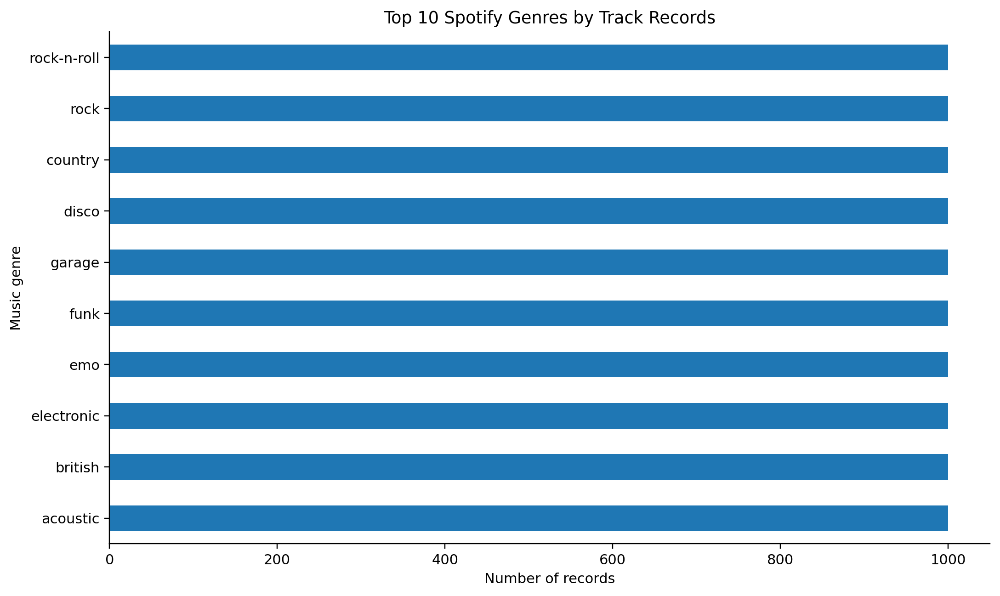
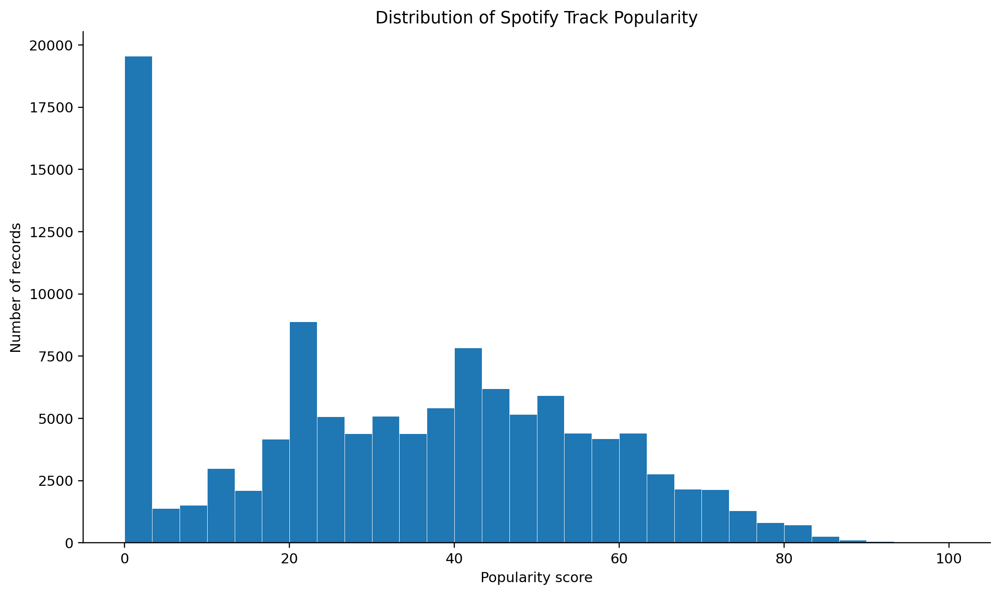
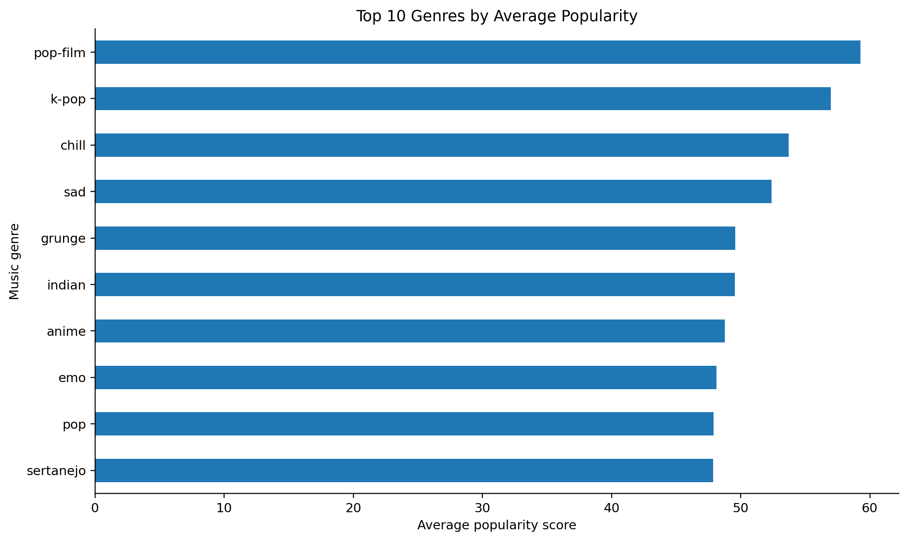
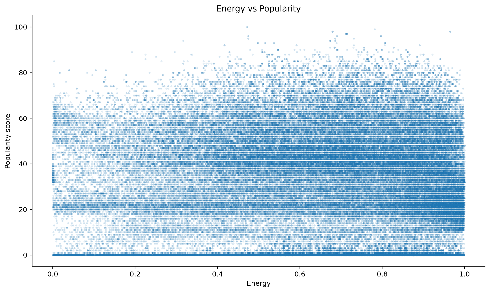
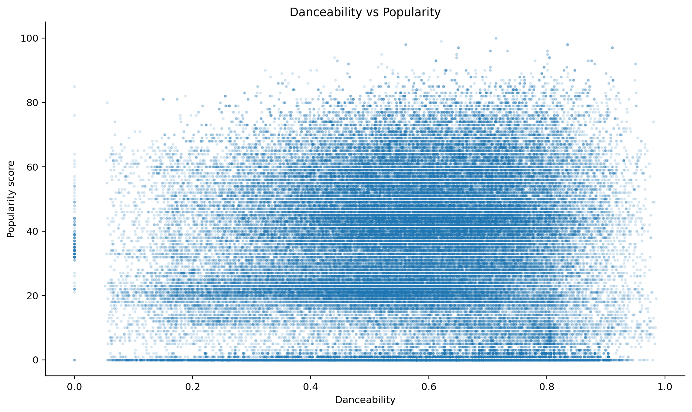
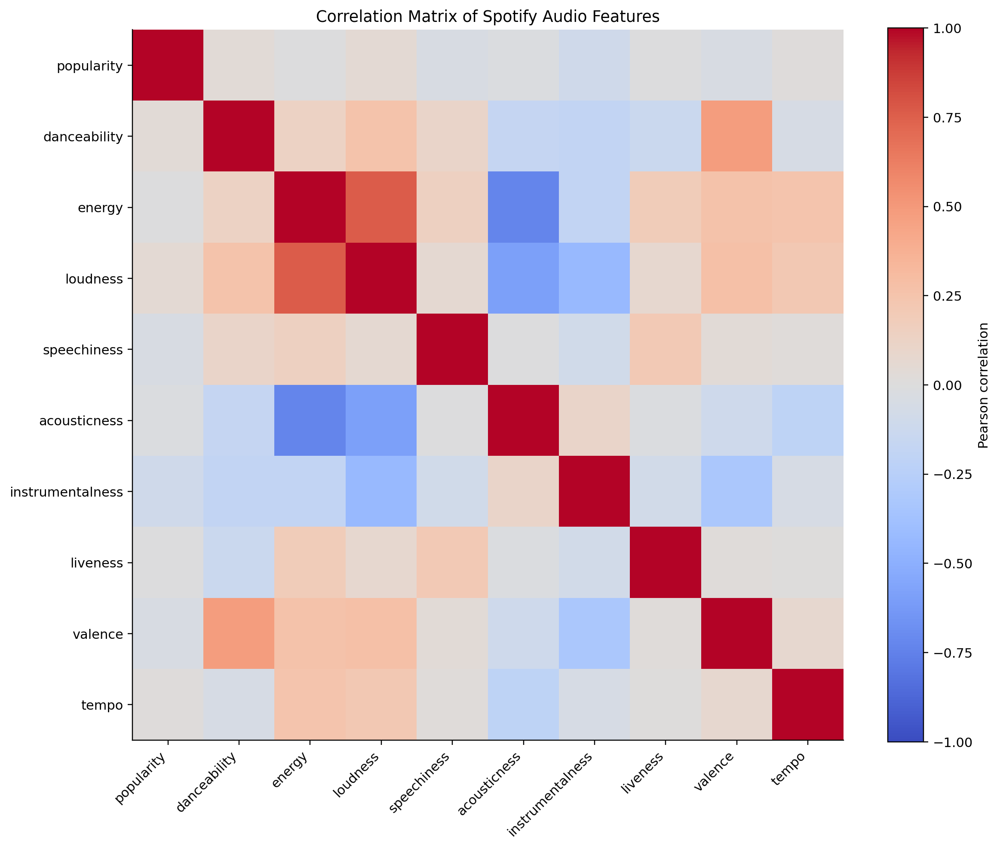
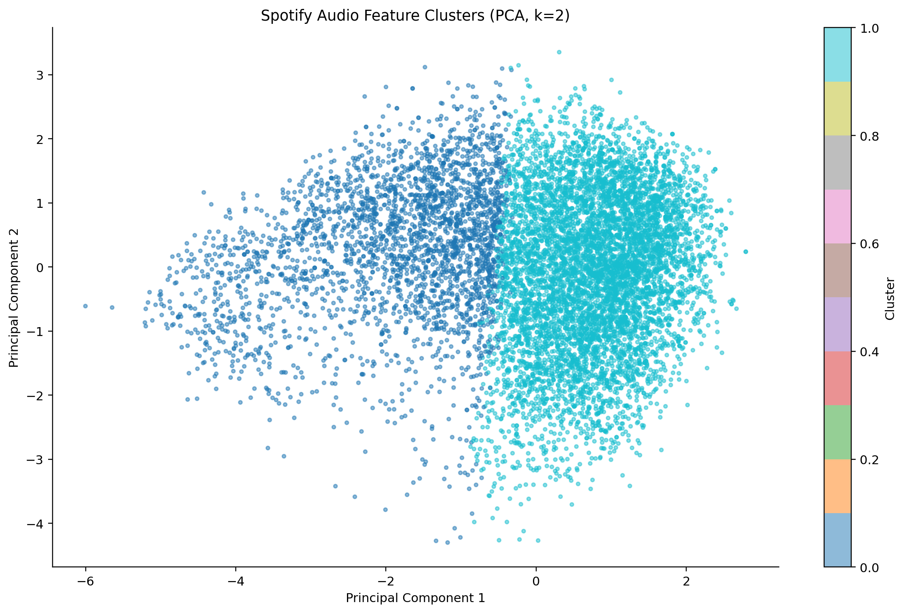

# Spotify Music Data Analysis & Machine Learning

**Data Science Portfolio Project | Python | Pandas | Matplotlib | Scikit-learn**

## Project Overview

This project explores Spotify music data through data cleaning, exploratory data analysis (EDA), statistical visualization, and unsupervised machine learning.

The original dataset contains approximately **114,000 track records across 114 music genres**.

The main objective is to investigate relationships between musical characteristics and track popularity, identify patterns across genres, and group tracks according to similarities in their audio features.

The project demonstrates an end-to-end data science workflow, from raw data preparation to visualization, clustering, model evaluation, and interpretation.

## Project Objectives

- Prepare and clean a real-world music dataset.
- Explore the distribution of Spotify track popularity.
- Identify the most represented music genres.
- Compare average popularity across genres.
- Analyze relationships between audio characteristics and popularity.
- Investigate correlations between numerical audio features.
- Apply unsupervised machine learning to identify groups of similar tracks.
- Evaluate clustering performance using Silhouette Scores.
- Visualize clustering results using Principal Component Analysis (PCA).
- Interpret findings and discuss methodological limitations.

## Dataset

**Source:** [Spotify Tracks Dataset — Kaggle](https://www.kaggle.com/datasets/maharshipandya/-spotify-tracks-dataset)

**Dataset Creator:** Maharshi Pandya

The original dataset includes approximately 114,000 records and 21 columns.

### Selected Dataset Features

| Feature | Description |
|---|---|
| `track_name` | Track title |
| `artists` | Performing artist(s) |
| `track_genre` | Assigned music genre |
| `popularity` | Spotify popularity score |
| `duration_ms` | Track duration in milliseconds |
| `danceability` | Suitability for dancing |
| `energy` | Perceived intensity and activity |
| `acousticness` | Confidence that a track is acoustic |
| `instrumentalness` | Estimated instrumental content |
| `liveness` | Confidence in the presence of a live audience |
| `valence` | Musical positiveness |
| `tempo` | Estimated beats per minute |

**Important:** Individual tracks may appear in multiple genre categories. Consequently, record counts should not automatically be interpreted as counts of unique songs.

## Methodology

### 1. Data Cleaning

The data cleaning pipeline performs:

- Inspection and handling of missing values.
- Removal of unnecessary index columns.
- Removal of exact duplicate records after dropping the index column.
- Validation of numerical fields.
- Validation of audio feature ranges.
- Conversion of track duration from milliseconds into minutes.
- Export of the cleaned dataset.

The original dataset is preserved for reproducibility.

**Script:** `src/data_cleaning.py`

**Generated file:** `data/spotify_cleaned.csv`

### 2. Exploratory Data Analysis (EDA)

The exploratory analysis investigates:

- Top 10 music genres by record count.
- Distribution of Spotify popularity scores.
- Top 10 music genres by average popularity.
- Relationship between energy and popularity.
- Relationship between danceability and popularity.
- Pearson correlations among selected numerical audio features.

The analysis generates six visualizations and three statistical summary tables.

**Script:** `src/eda.py`

### 3. Machine Learning — Music Clustering

Unsupervised learning is implemented using **MiniBatch K-Means**.

The clustering workflow includes:

1. Selection of seven numerical audio features.
2. Feature standardization using `StandardScaler`.
3. Evaluation of cluster counts ranging from 2 to 8 using a sample.
4. Selection of the number of clusters based on the sampled Silhouette Score.
5. Application of MiniBatch K-Means to the cleaned dataset.
6. Calculation of average audio characteristics for each cluster.
7. Two-dimensional visualization using PCA.

The clustering analysis uses:

- Danceability
- Energy
- Acousticness
- Instrumentalness
- Liveness
- Valence
- Tempo

**Script:** `src/clustering.py`

## Technologies

| Category | Technology |
|---|---|
| Programming Language | Python |
| Data Processing | Pandas, NumPy |
| Data Visualization | Matplotlib |
| Machine Learning | Scikit-learn |
| Clustering | MiniBatch K-Means |
| Feature Scaling | StandardScaler |
| Dimensionality Reduction | PCA |
| Model Evaluation | Silhouette Score |
| Version Control | Git, GitHub |

## Project Structure

```text
spotify-music-data-analysis/
├── data/
│   ├── dataset.csv
│   └── README.md
│
├── src/
│   ├── data_cleaning.py
│   ├── eda.py
│   └── clustering.py
│
├── results/
│   ├── README.md
│   ├── top_10_genres.png
│   ├── popularity_distribution.png
│   ├── genre_popularity.png
│   ├── energy_vs_popularity.png
│   ├── danceability_vs_popularity.png
│   ├── correlation_matrix.png
│   ├── spotify_clusters_pca.png
│   ├── top_10_genres.csv
│   ├── genre_popularity.csv
│   ├── correlation_matrix.csv
│   ├── cluster_summary.csv
│   └── silhouette_scores.csv
│
├── .gitignore
├── requirements.txt
└── README.md
```

The cleaned dataset is generated locally when the data cleaning script runs. The original dataset remains unchanged.

## Installation

Clone the repository:

```bash
git clone https://github.com/Nikol24/spotify-music-data-analysis.git
```

Navigate to the project directory:

```bash
cd spotify-music-data-analysis
```

Install the required libraries:

```bash
pip install -r requirements.txt
```

## Running the Analysis

Execute the scripts in the following order.

**Step 1 — Data Cleaning**

```bash
python src/data_cleaning.py
```

**Step 2 — Exploratory Data Analysis**

```bash
python src/eda.py
```

**Step 3 — Machine Learning Clustering**

```bash
python src/clustering.py
```

The data cleaning script must run first because the EDA and clustering scripts require `spotify_cleaned.csv`.

## Results & Visualizations

The following visualizations present the results of the Spotify exploratory data analysis and clustering workflow.

### 1. Top 10 Music Genres

This chart shows the ten music genres with the highest number of dataset records.



### 2. Popularity Distribution

This histogram illustrates the distribution of Spotify popularity scores across the analyzed records.



### 3. Average Popularity by Genre

This visualization compares the ten genres with the highest average popularity scores.



### 4. Energy vs Popularity

This scatter plot explores the relationship between the energy of a track and its popularity.



### 5. Danceability vs Popularity

This visualization investigates how danceability varies across Spotify popularity scores.



### 6. Audio Feature Correlation Matrix

The correlation matrix summarizes linear relationships among selected audio features and popularity.



### 7. Music Clustering — PCA Visualization

PCA reduces the seven-dimensional standardized audio feature space to two dimensions for visualization.

The scatter plot displays the cluster assignments produced by MiniBatch K-Means.



## Key Findings — Music Clustering

The clustering analysis identified **two groups** of Spotify track records based on seven standardized audio characteristics.

### Cluster Comparison

| Feature | Cluster 0 | Cluster 1 |
|---|---:|---:|
| Danceability | 0.474 | 0.605 |
| Energy | 0.351 | 0.761 |
| Acousticness | 0.688 | 0.161 |
| Instrumentalness | 0.278 | 0.106 |
| Liveness | 0.182 | 0.226 |
| Valence | 0.310 | 0.541 |
| Tempo (BPM) | 110.549 | 126.928 |
| Record Count | 32,944 | 80,605 |

### Cluster 0 — Acoustic & Mellow Characteristics

**Records:** 32,944 (approximately 29%)

This cluster is characterized by:

- Lower average energy (0.351).
- Lower average danceability (0.474).
- Higher acousticness (0.688).
- Higher instrumentalness (0.278).
- Lower average valence (0.310).
- Average tempo of approximately 110.5 BPM.

These characteristics suggest a relatively more acoustic and lower-energy audio profile.

The label is descriptive and does not represent a formally validated musical genre.

### Cluster 1 — Energetic & Rhythmic Characteristics

**Records:** 80,605 (approximately 71%)

This cluster is characterized by:

- Higher average energy (0.761).
- Higher average danceability (0.605).
- Lower acousticness (0.161).
- Lower instrumentalness (0.106).
- Higher average valence (0.541).
- Average tempo of approximately 126.9 BPM.

These characteristics suggest a relatively more energetic and rhythmic audio profile.

The label describes average audio characteristics rather than a definitive genre classification.

### Cluster Evaluation — Silhouette Score

The MiniBatch K-Means algorithm was evaluated for cluster counts ranging from 2 to 8.

| Number of Clusters (K) | Silhouette Score |
|---|---:|
| **2** | **0.2588** |
| 3 | 0.1910 |
| 4 | 0.1434 |
| 5 | 0.2034 |
| 6 | 0.1692 |
| 7 | 0.2097 |
| 8 | 0.2096 |

The highest sampled Silhouette Score was approximately **0.259 at K = 2**.

This indicates that the two-cluster configuration achieved the best separation among the evaluated configurations under the selected sampling procedure.

However, the relatively low score suggests that the clusters are not strongly separated.

Therefore, the identified groups should be interpreted as broad differences in average audio characteristics rather than distinct natural musical categories.

## Discussion

The clustering results highlight differences between two broad audio profiles.

Cluster 0 contains records with higher average acousticness and lower average energy, while Cluster 1 contains records with higher energy, danceability, valence, and tempo.

The substantial difference in average energy and acousticness suggests that these features contribute to distinguishing the two groups.

Nevertheless, the relatively low Silhouette Score demonstrates the limitations of clustering complex musical data into a small number of clearly separated groups.

The analysis illustrates how unsupervised machine learning can be used to explore patterns in music data, while also emphasizing the importance of evaluating and interpreting model outputs critically.


## Key Findings — Exploratory Data Analysis

### Audio Feature Correlations

The Pearson correlation analysis revealed several
notable relationships between audio features:

- Energy and loudness: r = 0.761
- Energy and acousticness: r = -0.733
- Loudness and acousticness: r = -0.588
- Danceability and valence: r = 0.477

Energy and loudness exhibited a strong positive
linear correlation, while energy and acousticness
showed a strong negative correlation.

These findings suggest that tracks with higher
energy tend to be louder and less acoustic
within the analyzed dataset.

### Popularity and Audio Features

Popularity showed weak linear relationships with
the examined audio characteristics.

Examples include:

- Popularity and instrumentalness: r = -0.095
- Popularity and energy: r = -0.002
- Popularity and danceability: r = 0.034
- Popularity and loudness: r = 0.047

These results indicate that individual audio
features have limited linear association with
popularity in this dataset.

However, weak linear correlations do not rule out
nonlinear relationships or interactions between
multiple features.

### Most Popular Music Genres

The three genres with the highest average
popularity scores were:

1. Pop-film: 59.28
2. K-pop: 56.96
3. Chill: 53.70

These results reflect average popularity scores
within the analyzed dataset and should not be
interpreted as current global Spotify rankings.

### Overall EDA Interpretation

The analysis identified clear relationships among
several audio characteristics, particularly energy,
loudness, acousticness, and valence.

In contrast, popularity was not strongly linearly
associated with any single examined audio feature.

This highlights the importance of considering
additional variables and potentially nonlinear
methods when investigating music popularity.

## Limitations

- Spotify popularity scores are time-dependent and can change.
- Repeated track identifiers may occur across music genres.
- Genre-level record counts should not be interpreted as counts of unique songs.
- Correlation does not imply causation.
- Audio features cannot fully represent listeners' subjective music preferences.
- Cluster assignments depend on the selected features, scaling method, and clustering algorithm.
- The number of clusters was selected using sampled Silhouette Scores rather than exhaustive full-dataset evaluation.
- The relatively low Silhouette Score indicates limited separation between clusters.
- PCA provides a two-dimensional approximation of the higher-dimensional feature space.
- Cluster labels are descriptive interpretations rather than validated genre classifications.

## Conclusion

This project demonstrates a Python-based data science workflow combining data cleaning, exploratory analysis, statistical visualization, and unsupervised machine learning.

The analysis provides a structured approach to exploring Spotify track characteristics and identifying broad differences between groups of audio profiles.

MiniBatch K-Means produced a two-cluster solution with distinguishable average characteristics, although the cluster evaluation revealed limitations in separation quality.

The project highlights the importance of combining technical implementation with careful statistical interpretation and transparent reporting of methodological limitations.

## Author

**GitHub:** [Nikol24](https://github.com/Nikol24)

*Data Science Portfolio — Spotify Music Analysis & Unsupervised Machine Learning*
